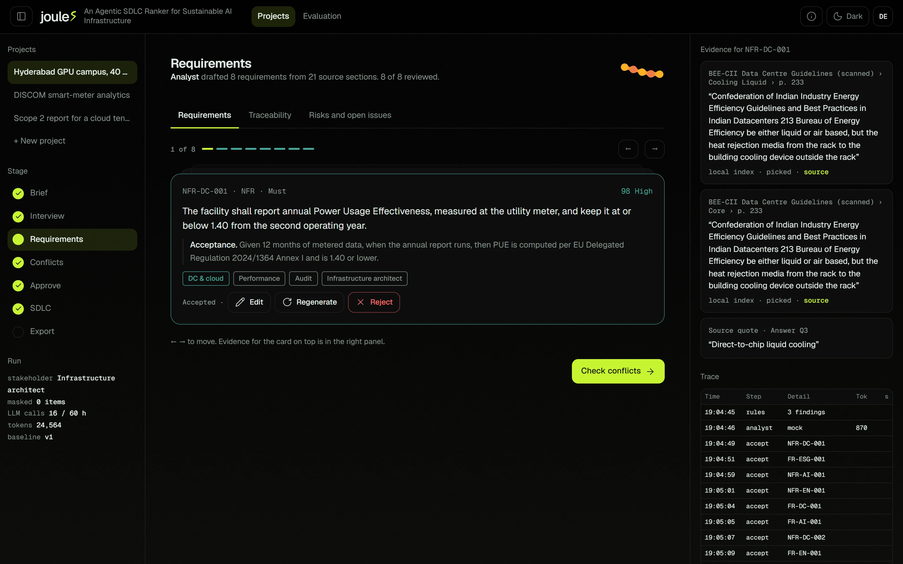
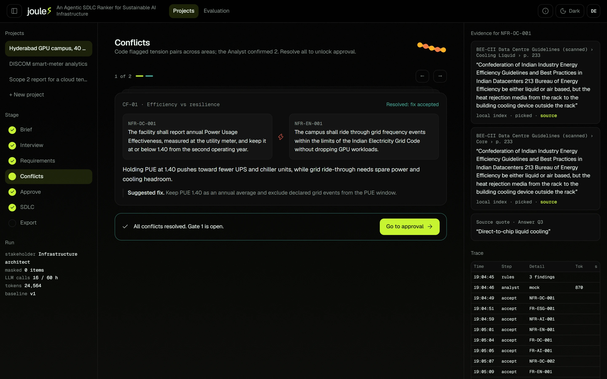
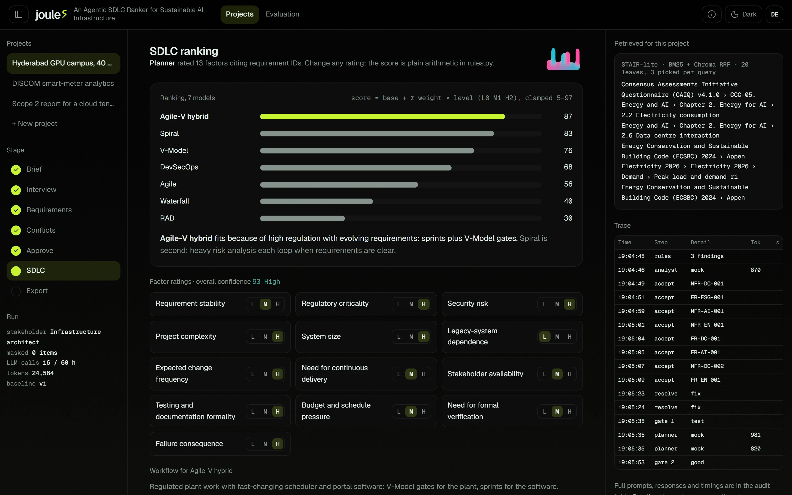
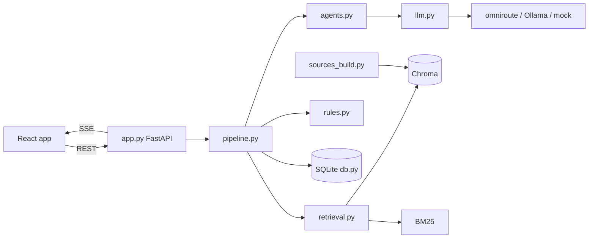
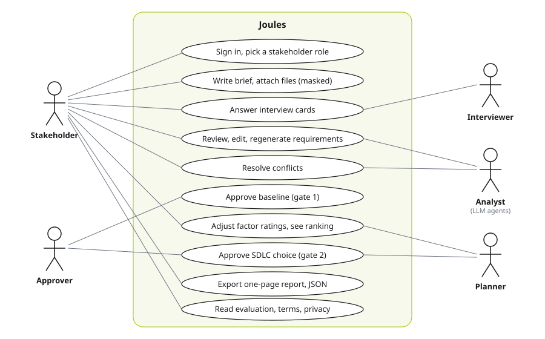
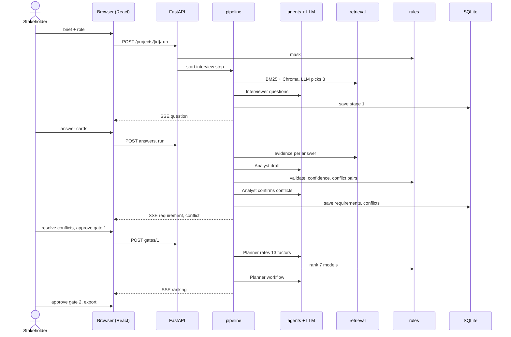

# joules

**An Agentic SDLC Ranker for Sustainable AI Infrastructure.**

Joules interviews a stakeholder, drafts requirements grounded in 40+ public laws and standards on energy, AI governance,
data centres and cloud, and carbon/ESG reporting, finds conflicts between them, and ranks seven SDLC models with a score
you can recompute by hand. People approve at two gates. Every requirement cites a document, section and page.



**Live demo:** https://joules.ashybay-bab00727.centralindia.azurecontainerapps.io (sign-in is invite-only; the first load after idle takes a few seconds). It answers with the offline mock model; live models are off unless the author's gateway is running.

## What it does

1. **Brief.** Pick a stakeholder role, write a brief, attach up to two files. Personal data is masked before any model sees it.
2. **Interview.** The Interviewer asks 3 to 4 multiple-choice cards per round; round 2 only covers gaps.
3. **Requirements.** The Analyst drafts requirements with evidence from STAIR-lite retrieval. Code assigns IDs, checks
   wording, drops invented citations and scores confidence 0 to 100.
4. **Conflicts.** Code proposes tension pairs across areas (efficiency vs resilience, retention vs privacy...); the Analyst
   confirms and suggests a fix. Gate 1 stays locked until each one is resolved.
5. **SDLC.** The Planner rates 13 factors citing requirement IDs; `rules.rank` scores 7 models deterministically; the Planner
   writes the workflow. Gate 2 approves the choice.
6. **Export.** One A4 page (print to PDF, no PDF library) and a JSON download.

| | |
|---|---|
|  |  |
|  |  |

## How it works



| File | What it does |
|---|---|
| `backend/app.py` | FastAPI routes, login cookie, owner checks, one SSE stream per project; serves the built UI |
| `backend/pipeline.py` | Runs each step as a background task, saves the stage in SQLite, publishes typed events |
| `backend/agents.py` | Prompts and Pydantic output schemas for the Interviewer, Analyst and Planner |
| `backend/llm.py` | One OpenAI-compatible client: JSON mode, validate + 1 retry, fallback chain, audit log, rate limits |
| `backend/retrieval.py` | STAIR-lite: BM25 + Chroma fused by RRF (top 20), the LLM picks the top 3 by breadcrumb |
| `backend/rules.py` | No LLM: masking, validation, confidence, conflict pairs, SDLC ranking |
| `backend/db.py` | SQLite schema (7 tables), scrypt passwords, sessions, demo user and template projects |
| `backend/sources_build.py` | Builds a table-of-contents tree per document (outline, headings or page windows, OCR) |
| `backend/config.py` | Settings, model chain and input caps from `.env` |

**The LLM proposes, code verifies.** IDs, confidence, citation checks, conflicts and the SDLC score come from `rules.py`,
so the same factor levels always give the same ranking: `score = clamp(5, 97, base + Σ weight × level)`.

### Use-case diagram

<picture>
  <source media="(prefers-color-scheme: dark)" srcset="docs/use-case-dark.svg">
  
</picture>

### Sequence diagram



## Evaluation

`tests/eval.py` runs 5 seeded case studies through the real pipeline and 40 gold retrieval questions (BM25 vs hybrid vs
STAIR-lite).

## Run it locally (Windows, PowerShell)

```powershell
# backend: Python 3.12 via uv
uv sync
copy .env.example .env          # set PASSWORD; OMNIROUTE_API_KEY only for live models
uv run python backend/sources_build.py   # once, about 5 minutes: needs the PDFs in sources-raw/
uv run uvicorn app:app --app-dir backend --port 8010

# frontend, second terminal
cd frontend
npm install
npm run dev -- --port 5180      # open http://localhost:5180
```

Mock mode is the default model, so the app runs fully offline. Sign in as `admin@joules.app` with your `PASSWORD`.
Tests: `uv run pytest`. Lint: `uv run ruff check backend tests` and `npx biome check src`.

## Dependencies

| Dependency | Why |
|---|---|
| FastAPI + uvicorn | Typed routes and built-in SSE (`fastapi.sse`) |
| Pydantic v2 | Validates LLM JSON and request caps |
| openai SDK | One client for omniroute (Groq, Gemini) and Ollama |
| chromadb | Vector store with its built-in MiniLM embedder |
| rank_bm25 | Keyword half of hybrid search |
| pymupdf | Outlines, font sizes and OCR in one library (AGPL, hence this licence) |
| python-dotenv | Loads `.env` |
| pytest + httpx, ruff | Tests and lint |
| React 19 + Vite + TypeScript | UI |
| Tailwind v4 | Utility classes next to the ported design tokens |
| lucide-react, motion, driver.js | Icons, spring animations, first-run tour |
| Biome | Frontend lint and format |

## Project structure

```
backend/     9 Python files (above)
frontend/    React app: src/pages, src/stages, src/components, api.ts, help.ts, index.css
tests/       pytest, fixtures (mock LLM answers, templates, case studies), eval.py
sources/     manifest.csv: file, licence, link, jurisdiction, date, version, public flag
docs/        screenshots
```

Raw sources (`sources-raw/`) and runtime data (`data/`) stay local. Sources marked not public (BEE, CSA, GHG Protocol,
IFRS, CII-LBNL) are never in the public index or this repository.

## Licence

AGPL-3.0 (PyMuPDF is AGPL-3.0). Not legal advice: outputs need human review and approval.
